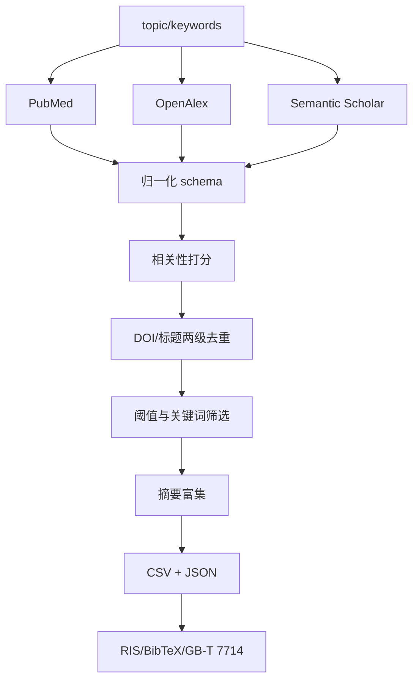

## Overview

在 PubMed、OpenAlex、Semantic Scholar 三个公开文献库上按主题或关键词检索论文，把异构结果归一化到统一 schema，按 DOI 与标题模糊匹配两级去重，再按相关性、引用数与年份做筛选，为缺摘要的文献从三个源依次补全摘要，最后导出可直接投稿使用的引用格式。

所有主题、关键词、年份范围与数据源都是命令行参数，不绑定任何具体疾病或课题，因此可用于任何研究方向的系统综述式检索。

## When to Use This Skill

- 需要围绕某个主题快速摸清 PubMed 上的文献分布（如 `antimicrobial peptide`、`protein structure prediction`）
- 需要跨多个文献库做覆盖更全的检索并合并去重
- 手头已有文献 CSV，但需要重新打分、筛选、清洗
- 手头有一批文献缺摘要，需要从 OpenAlex / Semantic Scholar 补全
- 需要把文献列表导出为 RIS / BibTeX / GB/T 7714 参考文献格式

## Quick Start

```bash
export PYTHONPATH="$PWD/packages"

# 1) 单源检索（PubMed）
python skills/literature-search/scripts/search_literature.py \
    --topic "antimicrobial peptide" --source pubmed \
    --date-range 2020: --max-results 50 \
    --output results/amp_pubmed.csv

# 2) 三源联合检索 + 摘要富集 + 相关性过滤
python skills/literature-search/scripts/search_literature.py \
    --topic "protein structure prediction" \
    --keywords "AlphaFold" "molecular dynamics" \
    --source pubmed openalex semantic-scholar \
    --date-range 2018:2024 --min-citations 20 --enrich-abstracts \
    --sort-by relevance --output results/prediction.csv

# 3) 离线处理已有 CSV（不联网）：重新打分 + 去重 + 排除词筛选
python skills/literature-search/scripts/search_literature.py \
    --input results/raw.csv --keywords "antifungal" \
    --exclude-terms "review" "protocol" \
    --min-relevance 3 --output results/filtered.csv

# 4) 导出引用格式
python skills/literature-search/scripts/export_citations.py \
    --input results/prediction.csv --format bibtex ris gbt7714 \
    --output-dir results/citations
```

## Workflow

1. **检索**：按 `--source` 逐源调用 API
   - PubMed：`esearch.fcgi` 拿 PMID → `esummary.fcgi` 批量拿元数据
   - OpenAlex：`works` 端点，用 `filter=from_publication_date:...,to_publication_date:...` 做年份过滤
   - Semantic Scholar：`graph/v1/paper/search`，用 `year=起始-结束` 做年份过滤
2. **归一化**：所有记录统一为 `title/authors/year/doi/journal/abstract/citations/source/pmid/url/type/oa_status`
3. **打分**：按关键词命中（标题权重 3.0、摘要权重 1.0）+ 引用数对数饱和 + 近期加成，得到 `relevance`
4. **去重**：DOI 精确匹配优先，其次标题归一化后的 `difflib` 模糊匹配（默认阈值 0.92）；被去掉的记录信息合并回保留记录（补摘要、累计引用、标记多来源）
5. **筛选**：相关性与引用数阈值 + 包含/排除词 + 年份区间
6. **摘要富集**（可选）：PubMed(efetch XML) → OpenAlex(倒排索引重建) → Semantic Scholar(abstract/tldr) 依次尝试
7. **导出**：统一 schema CSV（UTF-8 BOM，Excel 直开）+ 可选 JSON



## Parameters

| 参数 | 说明 | 默认值 |
| --- | --- | --- |
| `--topic` | 自由文本检索主题（作为主检索式） | 无 |
| `--keywords` | 附加关键词，AND 收窄检索 + 参与相关性打分 | 空 |
| `--source` | 数据源，可多选：`pubmed` / `openalex` / `semantic-scholar` | `pubmed` |
| `--date-range` | 年份区间 `START:END`，如 `2018:2024`、`2020:`、`:2015` | 不限 |
| `--max-results` | 每源每查询最大返回条数 | 50 |
| `--input` | 已有 CSV（提供时不联网） | 无 |
| `--output` | 输出 CSV 路径 | `<root>/results/literature_results.csv` |
| `--json-output` | 额外输出完整 JSON | 无 |
| `--min-citations` | 最低引用数 | 0 |
| `--min-relevance` | 最低相关性得分 | 0 |
| `--min-abstract-length` | 最短摘要长度 | 0 |
| `--include-terms` / `--exclude-terms` | 必含 / 必排关键词 | 空 |
| `--title-similarity` | 标题模糊去重阈值 | 0.92 |
| `--enrich-abstracts` | 开启摘要富集 | 关闭 |
| `--sort-by` | `relevance` / `citations` / `year` | `relevance` |
| `--email` | 联系邮箱（OpenAlex 礼貌池、NCBI 建议提供） | 无 |
| `--ncbi-api-key` / `--s2-api-key` | API Key（环境变量 `NCBI_API_KEY` / `S2_API_KEY` 优先） | 无 |

## Outputs

| 文件 | 说明 |
| --- | --- |
| `literature_results.csv` | 主结果，UTF-8 BOM，列：`title, authors, year, doi, journal, abstract, citations, source, pmid, url, type, oa_status, relevance, query` |
| `<name>.json` | 完整记录（含解析出的字段，便于二次处理） |
| `references.bib` | BibTeX 格式，`@article{作者姓+年份+首词+序号}` 稳定键 |
| `references.ris` | RIS 格式，EndNote / Zotero / Mendeley 可直接导入 |
| `references.txt` | GB/T 7714-2015 顺序编码制 或 中文编号纯文本 |

## Validation

- **检索覆盖**：确认三个源各自返回条数符合预期；某个源为 0 条通常是年份过滤过窄或 API Key 缺失导致限速
- **去重有效性**：去重前后条数差应接近各源之间真实重复量；`source` 列出现 `A+B` 说明该文献被多个源命中
- **摘要完整度**：摘要富集后检查 `abstract` 列空值率；OpenAlex 摘要来自倒排索引重建，若原库无摘要则仍然为空
- **相关性合理性**：抽查 `relevance` 排序前 20 条，确认主题相关；`--min-relevance` 阈值建议先设为 0 观察分布再收紧
- **引用格式**：导入 Zotero/EndNote 检查作者名、卷期页码是否被正确解析；GB/T 7714 输出需人工核对卷(期)与页码（部分源不提供）
- **引用计数口径**：`citations` 各源定义不同（PubMed 为 pmcrefcount，OpenAlex 为 cited_by_count），跨源比较时只作相对参考

## References

- `references/methodology.md` —— 检索策略设计、各源 API 参数、相关性评分与去重算法原理
- `references/troubleshooting.md` —— 常见报错（限速、空结果、编码、重复条目）与排错步骤
