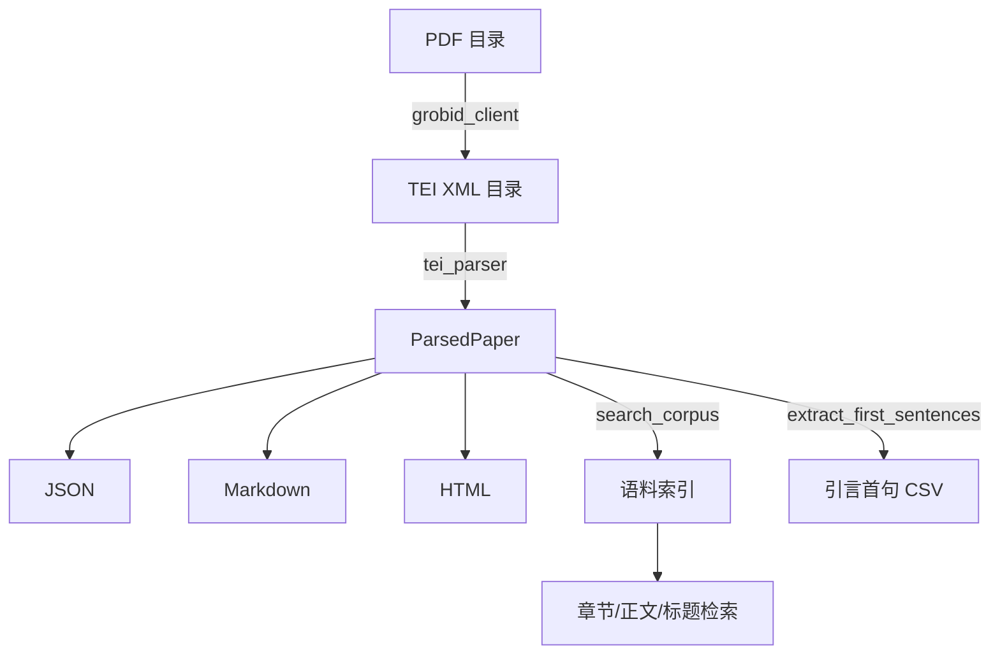

## Overview

把一批科研 PDF 变成可检索、可引用的结构化全文：

```
PDF 目录 ──GROBID(本地服务)──► TEI XML ──解析──► JSON / Markdown / HTML
                                                 └──► 语料索引（章节/正文/标题检索）
                                                 └──► 引言首句 CSV
```

GROBID 是本地部署的 Java 服务（不是云 API），负责把 PDF 的版面信息还原成带章节层级、图表位置、参考文献条目的 TEI XML；本技能负责后续的解析、转换、索引与检索。

技术上从老仓库 `paper_extract/` 移植而来，修掉了 5 个真实缺陷：关键词被空格切开、标题误判、章节树重复计数、参考文献数量多算 1 条、`xml:id` 取不到值。

## When to Use This Skill

- 手里有一批论文 PDF，需要**结构化**元数据（标题/作者/摘要/关键词/DOI/期刊），而不是纯文本
- 需要把论文转成 Markdown 或 HTML 以便本地阅读、翻译或喂给 LLM
- 需要在几十上百篇文献里做**跨文献全文检索**（"哪些论文提到 off-target"）
- 需要快速扫读一批论文的**引言首句**来判断相关性（每段第一句通常就点明了这篇文章要解决什么）
- 需要抽取每篇论文的**参考文献列表**用于引文网络分析

## Quick Start

```bash
export PYTHONPATH="$PWD/packages"

# 0) 部署 GROBID（只需一次；首次启动要下模型，等日志出现 "Server started"）
docker run -it -p 8070:8070 kermitt/grobid

# 1) 全流程：PDF → TEI → JSON/Markdown/HTML + 语料索引
python skills/paper-fulltext-extract/scripts/extract_fulltext.py \
    --pdf-dir ./pdfs --output ./out \
    --formats json,markdown,html --build-index

# 2) 只提取引言首句（快速扫读一批论文）
python skills/paper-fulltext-extract/scripts/extract_fulltext.py \
    --tei-dir ./tei --output ./out --intro-only

# 3) 已有 TEI XML，只做解析
python skills/paper-fulltext-extract/scripts/tei_parser.py \
    --input ./tei/paper.tei.xml \
    --json out/paper.json --markdown out/paper.md --html out/paper.html

# 4) 单独调 GROBID 批量转 PDF（支持断点续跑）
python skills/paper-fulltext-extract/scripts/grobid_client.py \
    --input ./pdfs --output ./tei --check-only

# 5) 全文检索
python skills/paper-fulltext-extract/scripts/search_corpus.py \
    --xml-dir ./tei --keyword "CRISPR" --scope all \
    --export-csv out/corpus_metadata.csv
```

## Workflow

1. **PDF → TEI**（可选，需 GROBID 服务）
   - `POST /api/processFulltextDocument`，文件字段名固定为 `input`
   - `consolidateHeader` / `consolidateCitations` 默认开启；`flavor` 选 `precision`（准）或 `speed`（快）
   - 批量处理支持**断点续跑**：已存在 `<name>.tei.xml` 直接跳过
2. **TEI → 结构化数据**
   - 元数据：标题、作者、机构、摘要、关键词、DOI、年份、期刊
   - 正文：章节树（`<div>` 可嵌套，层级保留）
   - 图表：编号、图注、图形相对路径
   - 参考文献：只取 `<back>` 下的条目
3. **产出多格式**：JSON（机器可读）/ Markdown（阅读与喂 LLM）/ HTML（带图注与样式）
4. **建索引 + 检索**：章节标题 / 正文段落 / 论文标题三种范围，可导出元数据 CSV
5. **引言首句提取**：每篇每个引言段落的第一个句子，导出 CSV 用于快速筛读



## Parameters

### `extract_fulltext.py`（主入口）

| 参数 | 说明 | 默认值 |
| --- | --- | --- |
| `--pdf-dir` | PDF 输入目录（触发 GROBID 步骤） | 无 |
| `--tei-dir` | TEI XML 目录（跳过 GROBID 步骤） | 无 |
| `--output` | 输出目录（**必填**） | 无 |
| `--grobid-server` | GROBID 服务地址 | `http://127.0.0.1:8070` |
| `--flavor` | 抽取精度：`precision` / `speed` | `precision` |
| `--no-consolidate-header` | 关闭 `consolidateHeader` | 关闭（即默认开启） |
| `--no-consolidate-citations` | 关闭 `consolidateCitations` | 关闭（即默认开启） |
| `--pause` | GROBID 每篇之间的等待秒数 | `0` |
| `--formats` | 输出格式，逗号分隔：`json` / `markdown` / `html` | `json,markdown` |
| `--image-base` | HTML 中图像的相对目录前缀 | `images` |
| `--intro-only` | 只提取引言首句，不产出完整文档 | 关闭 |
| `--intro-section` | 引言章节名 | `introduction` |
| `--max-intro-sentences` | 每篇最多提取的引言首句数 | `3` |
| `--build-index` | 建立全文检索索引 | 关闭 |
| `--search` | 检索词（需配合 `--build-index`） | 无 |
| `--search-scope` | 检索范围：`paragraph` / `section` / `title` / `all` | `paragraph` |
| `--skip-grobid-check` | 跳过 GROBID 可用性检查 | 关闭 |

### `tei_parser.py`

| 参数 | 说明 | 默认值 |
| --- | --- | --- |
| `--input` | TEI XML 文件路径（**必填**） | 无 |
| `--json` / `--markdown` / `--html` | 输出文件路径 | 无 |
| `--image-base` | HTML 中图像的 URL 前缀 | 空 |

### `grobid_client.py`

| 参数 | 说明 | 默认值 |
| --- | --- | --- |
| `--input` / `--output` | PDF 输入目录 / TEI 输出目录 | 无 |
| `--server` | GROBID 服务地址 | `http://127.0.0.1:8070` |
| `--timeout` | 单次请求超时秒数 | `300` |
| `--max-retries` | 失败重试次数（含首次） | `3` |
| `--retry-delay` | 首次重试等待秒数（之后指数退避） | `5` |
| `--flavor` | `precision` / `speed` | `precision` |
| `--pause` | 每篇之间等待秒数 | `0` |
| `--check-only` | 仅检查服务可用性 | 关闭 |

### `search_corpus.py`

| 参数 | 说明 | 默认值 |
| --- | --- | --- |
| `--xml-dir` | TEI XML 目录（建立索引） | 无 |
| `--index-file` / `--load-index` | 索引 JSON 保存 / 载入路径 | 无 |
| `--keyword` | 检索词 | 无 |
| `--scope` | `paragraph` / `section` / `title` / `all` | `paragraph` |
| `--case-sensitive` | 区分大小写 | 关闭 |
| `--context` | 上下文长度（字符） | `100` |
| `--export-csv` | 导出元数据 CSV 路径 | 无 |
| `--show-structure` | 显示某个文件的章节结构 | 无 |

## Outputs

```
out/
├── json/       <name>.json      完整结构化数据（含章节树、图表、参考文献）
├── markdown/   <name>.md        Markdown 正文（标题/作者/关键词/摘要/章节）
├── html/       <name>.html      带图注与内联样式的 HTML
├── tei/        <name>.tei.xml   GROBID 原始输出（仅 --pdf-dir 模式）
├── corpus_index.json            语料索引（可 --load-index 复用）
├── corpus_metadata.csv          文献元数据表（UTF-8 BOM，Excel 直开）
├── search_hits.json             检索命中明细
└── intro_sentences.csv          引言首句表
```

`intro_sentences.csv` 列：`file, title, sentence_index, first_sentence`
`corpus_metadata.csv` 列：`file, title, keywords, n_sections, n_paragraphs, abstract_chars`

## Validation

- **GROBID 可用性**：脚本会先调 `/api/isalive` 探测；不可用时给出明确的部署命令。日志里出现 `Server started` 才算就绪
- **解析成功率**：`解析完成：成功 N 篇，失败 M 篇` —— 单篇 XML 损坏不会中断整批，损坏文件记入警告
- **标题正确性**：若标题显示为 `INTRODUCTION`、`Methods` 之类，说明 GROBID 把章节名误填进了 title，脚本会自动回退到文件名。**回退到文件名是正确行为**，比回退到期刊名好
- **关键词完整性**：多词关键词（`tumor necrosis factor`）应保持完整。若看到被拆成三个词，说明关键词走了空格分隔的兜底分支 —— 检查 TEI 里有没有 `<term>` 子元素
- **参考文献条数**：应等于论文末尾的条目数。若比实际多 1，多出来的是本文自己的元数据（`<sourceDesc>` 里的 `<biblStruct>`）
- **章节层级**：`corpus_index.json` 里 `sections[].level` 应体现嵌套关系；标题重复出现说明章节树解析有重复
- **输出目录**：所有产物都应平铺在 `out/json/`、`out/markdown/`、`out/html/` 下；出现嵌套子目录说明文件名推导用了绝对路径
- **引言首句质量**：首句应当是完整句子（以句号结尾），若在半句处截断说明缩写（如 `e.g.`）被误判为句末

## References

- `references/methodology.md` —— TEI 结构详解、GROBID 部署与参数、章节树与首句提取算法、修掉的 5 个老仓库缺陷原理
- `references/troubleshooting.md` —— 常见报错（服务不可达、404、标题误填、关键词被切、参考文献多算、输出目录逃逸）与排错步骤
