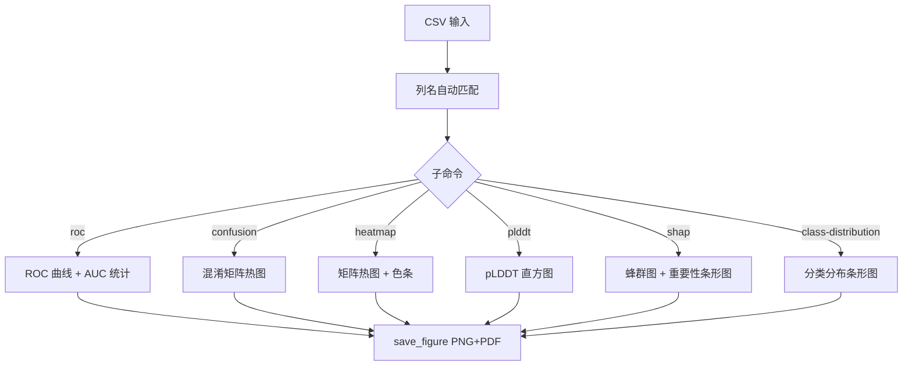

## Overview

用一个多子命令入口生成出版级科研图表，所有图共享同一套视觉规范（Arial 优先字体、
去除 top/right spines、关闭网格、色盲友好调色板、300/600 dpi 保存、tight bbox）。

统一的 `figure_style.py` 模块把原先散落在 15 个 `figN_*.py` 脚本里的样式逻辑
收敛为可复用组件，支持 `nature` / `cell` / `science` 三种期刊预设，并提供
ROC 显著性检验、自助法置信区间、SHAP 特征重要性排序等真实的统计能力。

## When to Use This Skill

- 需要为论文或报告生成 ROC 曲线、混淆矩阵、热图等标准图表
- 需要多个子图风格完全一致（同一篇论文里不能一个图 Arial 一个图 Times）
- 需要为机器学习结果生成 SHAP 摘要图或特征重要性图
- 需要给分子对接结果做结合能热图
- 需要给结构预测结果画 pLDDT 置信度分布

## Quick Start

```bash
export PYTHONPATH="$PWD/packages"

# ROC 曲线（含 AUC 显著性检验与自助法置信区间）
python skills/scientific-figures/scripts/make_figures.py roc \
    --input data/roc.csv --output figures/fig8_roc \
    --bootstrap-ci --fill-best --stats-output figures/fig8_roc_stats.csv

# 混淆矩阵热力图（多模型）
python skills/scientific-figures/scripts/make_figures.py confusion \
    --input data/confusion.csv --output figures/fig9_cm

# 分子对接结合能热图
python skills/scientific-figures/scripts/make_figures.py heatmap \
    --input data/docking.csv --output figures/fig11_docking \
    --cmap coolwarm_r --colorbar-label "Binding Energy (kcal/mol)" \
    --x-label Receptor --y-label Ligand --percentile-clip

# pLDDT 置信度直方图
python skills/scientific-figures/scripts/make_figures.py plddt \
    --input data/plddt.csv --output figures/fig3_plddt

# SHAP 摘要蜂群图 + 特征重要性条形图
python skills/scientific-figures/scripts/make_figures.py shap \
    --input data/shap.csv --output figures/fig10_shap --top-n 15 \
    --importance-output figures/fig10_importance.csv

# 门-纲分类分布
python skills/scientific-figures/scripts/make_figures.py class-distribution \
    --input data/taxa.csv --output figures/fig1_taxa --top-n 20
```

## Workflow

1. **加载样式**：`apply_publication_style(style)` 设置 rcParams（字体、spines、网格、dpi、色板）
2. **读取数据**：自动 BOM/分隔符嗅探，列名大小写不敏感匹配
3. **按子命令分发**：每个子命令是一个独立的绘图函数，共享统一的保存接口
4. **统计增强**（可选）
   - ROC：AUC 梯形积分、AUC 间 Z 检验（Hanley-McNeil 标准误）、自助法置信区间
   - 混淆矩阵：全局统一色阶 + 数值与百分比双标注
   - SHAP：平均绝对 SHAP 值排序、标准差、Top N 选择
5. **保存**：`save_figure()` 同时输出 PNG（位图，用于预览与文档）与 PDF（矢量，用于投稿）



## Parameters

| 参数 | 说明 | 默认值 |
| --- | --- | --- |
| `subcommand` | 图表类型（位置参数）：`roc` `confusion` `heatmap` `plddt` `shap` `class-distribution` `secondary-structure` `model-performance` `feature-importance` | 必填 |
| `--input` | 输入 CSV | 必填 |
| `--output` | 输出路径（不含扩展名时按 `--formats` 生成多个文件） | 必填 |
| `--style` | 期刊预设：`default` / `nature` / `cell` / `science` | `nature` |
| `--formats` | 输出格式 | `png pdf` |
| `--dpi` | 分辨率 | 300 |
| `--top-n` | 显示 Top N（SHAP / 分类分布 / 特征重要性） | 15 |
| `--bins` | 直方图分箱数（pLDDT） | 50 |
| `--cmap` | 热图色阶 | `coolwarm_r` |
| `--colorbar-label` / `--x-label` / `--y-label` | 热图标签 | `Value` / 空 |
| `--percentile-clip` | 热图色阶按 2%/98% 分位裁剪 | 关闭 |
| `--fill-best` | ROC 图填充最佳模型曲线下方 | 关闭 |
| `--bootstrap-ci` | ROC 图计算 AUC 自助法置信区间 | 关闭 |
| `--stats-output` | ROC 显著性检验结果 CSV | 无 |
| `--importance-output` | SHAP 特征重要性表 CSV | 无 |
| `--row-labels` | 热图首列是否作为行标签 | `auto` |

## Outputs

| 文件 | 说明 |
| --- | --- |
| `<output>.png` | 300/600 dpi 位图，适合预览、PPT、Word 嵌入 |
| `<output>.pdf` | 矢量图，适合投稿（期刊要求矢量图时用这个） |
| `<output>_beeswarm.png/pdf` | SHAP 蜂群图（`shap` 子命令） |
| `<output>_importance.png/pdf` | 特征重要性条形图（`shap` 子命令） |
| `<output>_stats.csv` | ROC 模型的 AUC 两两 Z 检验结果（`--stats-output`） |
| `<output>_importance.csv` | 全部特征的 mean_abs_shap 排名（`--importance-output`） |

## Validation

- **ROC**：图上的 AUC 标签应与 `--stats-output` 中的 AUC 一致；随机基线必须标注 `AUC = 0.50`
- **ROC 统计**：Z 检验的样本量 `--n-samples` 默认 500，是 Hanley-McNeil 近似的假设值；
  若实际样本量不同请显式传入，否则 p 值会有偏差
- **混淆矩阵**：所有子图共享同一色阶（脚本已固定全局 vmin/vmax），因此不同模型的
  格子颜色**可以横向比较**；若发现颜色深浅不一致说明数据被拆成了多行
- **热图**：色阶裁剪（`--percentile-clip`）后极端值会落在色阶边界，需在图注中说明
- **pLDDT**：三档配色（>90 绿 / 70–90 蓝 / <70 黄）与 AlphaFold 官方分档一致
- **SHAP**：蜂群图的纵轴顺序必须与重要性条形图一致（脚本共用同一 `top_features` 列表）
- **通用**：生成后检查 PNG 的实际像素尺寸与文字是否被裁切（tight bbox 正常，但极端长的
  X 轴标签仍需目视检查）
- **字体**：Arial 缺失时 matplotlib 会回退到 Helvetica/DejaVu Sans，
  最终投稿前请确认目标机器已安装 Arial，否则排版会有细微差异

## References

- `references/methodology.md` —— 样式规范、各图类型的统计方法与色板选择原理
- `references/troubleshooting.md` —— 常见报错、列名不匹配、字体与输出问题排查
